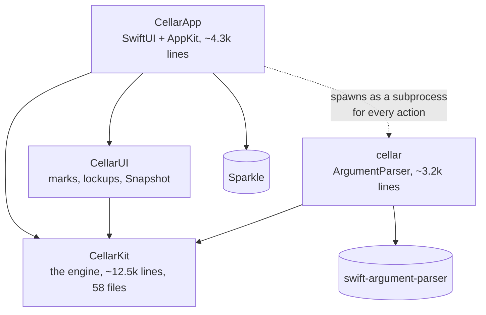
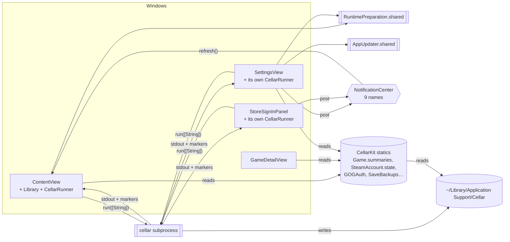
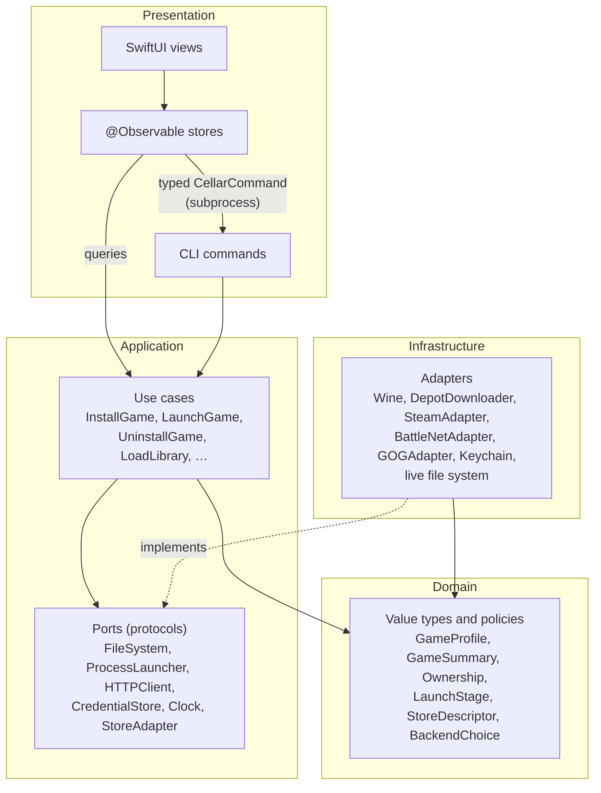
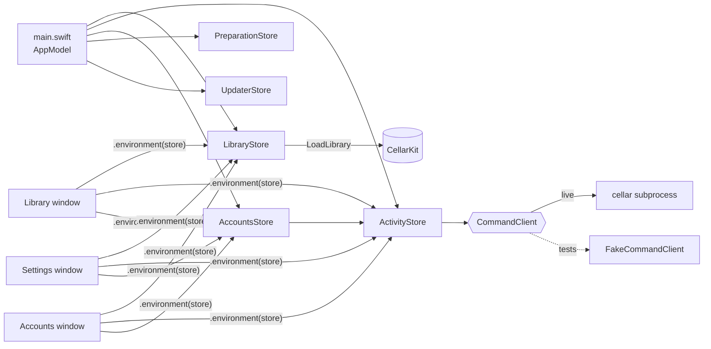
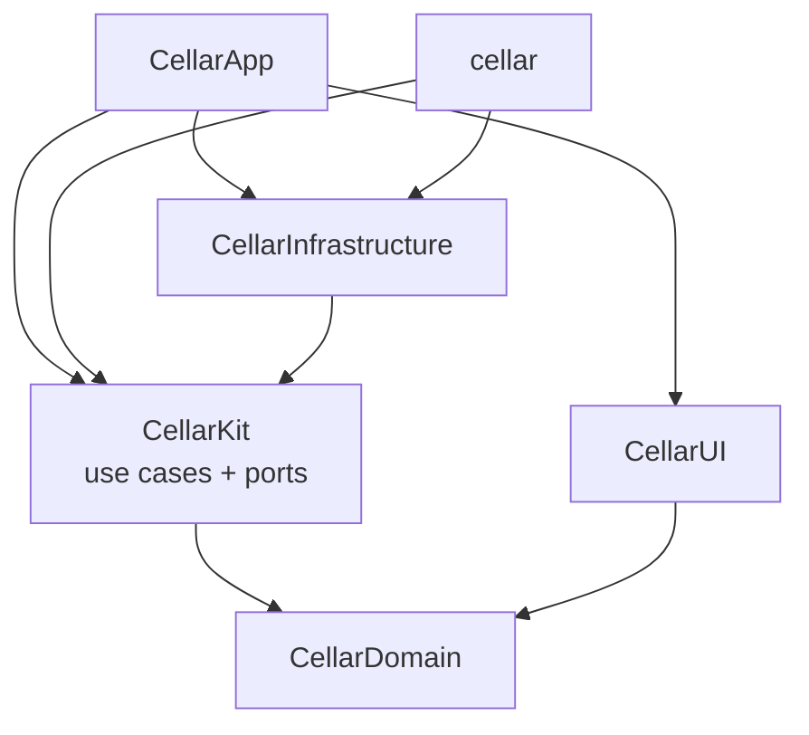

# App architecture — where Cellar is, and where it should go

> **Status:** proposal (#66). Nothing here has been refactored yet. The migration is tracked in
> #67 and lands one small, releasable step at a time (#68–#77).
>
> [`ARCHITECTURE.md`](ARCHITECTURE.md) explains *what Cellar does* — the translation stack, the store
> layer, bottles. This document is about *how the code is organised*: modules, layers, dependencies
> and the flow of state, judged against the clean-architecture practice backends take for granted.

## Contents

1. [Summary](#summary)
2. [How Cellar is built today](#how-cellar-is-built-today)
3. [What is good, and what is not](#what-is-good-and-what-is-not)
4. [Clean architecture, translated to a Swift app](#clean-architecture-translated-to-a-swift-app)
5. [State management: signal stores and their Swift equivalents](#state-management-signal-stores-and-their-swift-equivalents)
6. [The target architecture](#the-target-architecture)
7. [Migration plan](#migration-plan)
8. [Decisions and rejected alternatives](#decisions-and-rejected-alternatives)
9. [Sources](#sources)

## Summary

- **Cellar already has the most important clean-architecture property:** all logic lives in one
  UI-free core (`CellarKit`), and both front-ends (the `cellar` CLI and `CellarApp`) depend on it,
  never the other way round. That is worth keeping exactly as it is.
- **What it lacks is seams.** The core is a set of caseless `enum`s with `static func`s that touch the
  file system, processes, network and Keychain directly. There are no protocols, so nothing can be
  substituted in a test except through the process-wide `CELLAR_HOME` variable. Per-store behaviour
  is a `switch` repeated across ~38 sites. `Game.swift` is 1,100 lines of model, query and
  orchestration together.
- **The app's state is fragmented.** Three windows each own a separate `CellarRunner`, two
  singletons hold global state, views read engine statics directly, and windows coordinate through
  nine untyped `NotificationCenter` names.
- **Recommendation for state:** `@Observable` feature stores — Apple's Observation framework, which is
  the closest Swift equivalent of Angular's signals and NgRx's `signalStore` — owned by one
  composition root and injected into every window. Not TCA: it would solve problems Cellar does not
  have, at the price of a heavy third-party dependency and a rewrite.
- **Recommendation for the core:** use cases over ports (protocols for file system, processes,
  network, credentials, clock), one `StoreAdapter` per store, and eventually SwiftPM targets so the
  compiler enforces the dependency rule.
- **The CLI-as-subprocess boundary stays.** It is a real asset (crash isolation from Wine, a clean
  environment per action, one tested path). It gets a typed contract instead of string arrays.

## How Cellar is built today

### Modules



| Target | Role today | Clean-architecture equivalent |
|---|---|---|
| `CellarKit` | Everything: domain types (`GameSummary`, `Ownership`, `LaunchStage`), policies (`StoreLibrary.verdict`, `BackendChoice`), orchestration (`Game.setUp`, `Game.launch`), and every adapter to the outside world (`Wine`, `DepotTool`, `Keychain`, `Downloader`). | domain + application + infrastructure, in one module |
| `cellar` | One `ParsableCommand` per command group; formats output for a terminal. | presentation (CLI) + composition root |
| `CellarUI` | Store marks, lockups, the generated cover, `Snapshot`. A library so tests can import it. | presentation primitives |
| `CellarApp` | Windows, menus, views, `Library` and `CellarRunner` view models, the Sparkle updater. | presentation (GUI) + composition root |

The dependency direction is correct: nothing in `CellarKit` imports SwiftUI, AppKit or
ArgumentParser, and nothing points back at a front-end. This is the "dependency rule" of clean
architecture, already met at the module level.

### Inside CellarKit

Almost every type is a namespace:

```swift
public enum SaveBackups {
    public static func list(bottle: String) -> [Backup] { … FileManager.default … }
}
```

- **No protocols.** A `grep` for `protocol` in `Sources/CellarKit` finds none. Side effects —
  `FileManager`, `Process` (6 sites), `URLSession` (5), Keychain, `ProcessInfo.environment` — are
  called where they are needed.
- **Configuration is ambient.** `Paths.appSupport` reads `CELLAR_HOME` from the process environment,
  and every location is derived from it. That is how tests isolate the disk today: it works, but it
  is process-global, so two tests cannot use two homes at once.
- **Per-store behaviour is data *and* switches.** `StoreDescriptor` holds the facts as a table
  (good), but behaviour branches on `GameStore` at ~38 `case .steam` sites — 14 in `Game.swift`,
  more in `StoreLibrary`, `Preparation`, `Uninstall`, `Reset`, `StoreIcon` and the CLI's `Setup`.
- **`Game.swift` is the centre of gravity**: `GamePlan`, `GameFacts`, `LaunchRoute`, `GameSummary`,
  the library query (`Game.summaries()`) and the set-up/launch/uninstall orchestration, in 1,100
  lines.
- **Swift 5 language mode**, so no strict concurrency checking; `CellarLog` is
  `@unchecked Sendable`.

### How state flows in the app



The rule in [`skills/swift.md`](../skills/swift.md) is: *actions go through the CLI subprocess,
read-only state comes from CellarKit in-process*. That is, in effect, **CQRS**: commands travel one
path, queries another, and the file system under `Paths.appSupport` is the shared store between
them. After a command finishes, the app re-queries.

That split is sound. The problems are in how the app side is wired:

- **Three `CellarRunner`s.** `ContentView`, `SettingsView` and `StoreSignInPanel` each create one with
  `@StateObject`. "Busy" is per window, so Settings can start a command while the library is
  installing, and the library window does not know a sign-in is running.
- **Global singletons.** `RuntimePreparation.shared` and `AppUpdater.shared` are reached from any
  view.
- **Notifications as an event bus.** Windows tell each other what happened through
  `NotificationCenter` (`cellarAccountsChanged`, `cellarLibraryChecking`, `cellarRefreshLibrary`, …).
  Partly this is forced: Settings and Accounts are separate `NSWindow`s, because a SwiftUI `.sheet`
  inside `NSHostingView` trips the AttributeGraph crash (see `skills/swift.md`), so they do not share a
  view tree. But nothing typed says who listens to what.
- **Views read the engine directly**, e.g. `GameDetailView` calls `SaveBackups.list(…)` and
  `AccountsSection` reads `GOGAuth.isSignedIn`. Those reads touch the disk from inside a view update,
  and the view cannot be previewed or tested without a real Cellar home.
- **A stringly-typed command contract.** Call sites build `["saves", "restore", slug, "--backup", id]`
  by hand; the CLI reports progress by printing marker lines (`LaunchMarker`, `InstallMarker`) among
  the prose. A renamed flag fails at runtime, not at compile time.
- **The view models are `ObservableObject`**, so any `@Published` change invalidates every view
  observing the object. `CellarRunner.log` changes on every line of output.

### How it is tested today

The suite is strong for what it covers: 39 files of fast, hermetic engine tests, offscreen rendering
of the store marks in `CellarUITests`, and tiered Wine and Steam integration tests
([`TESTING.md`](TESTING.md)). Everything is tested at the level of pure functions, or end-to-end
against a real `CELLAR_HOME`. What cannot be tested today is the middle: an app state transition
("Settings signs in, the library refreshes"), or an engine flow with a failing download, without
standing up the real thing.

## What is good, and what is not

| Keep | Change |
|---|---|
| One UI-free core, two thin front-ends | Static-only engine with no seams for I/O |
| `StoreDescriptor` as a table of per-store facts | Per-store behaviour as repeated `switch`es |
| CLI subprocess for actions: crash isolation, clean environment, one tested path | Hand-built argument arrays and prose markers as the contract |
| Commands one path, queries another (CQRS) | Three runners, two singletons and a notification bus as the app's state |
| `CellarUI` as an importable library so views are testable | Views reading disk through engine statics |
| Honesty rules encoded in the engine (`Ownership` has three answers) | `Game.swift` as model + query + orchestration in one file |

## Clean architecture, translated to a Swift app

The backend idea — Robert C. Martin's Clean Architecture, Alistair Cockburn's ports and adapters
(hexagonal), Jeffrey Palermo's onion — reduces to three rules that transfer to an app unchanged:

1. **The dependency rule.** Source dependencies point inward. Domain knows nothing of use cases; use
   cases know nothing of SwiftUI, ArgumentParser, Wine or `FileManager`.
2. **Use cases are the application.** Each thing the system *does* (install a game, launch it, sign
   in) is one object with its dependencies passed in and one entry point. Front-ends call use cases;
   they do not orchestrate.
3. **Dependency inversion at the edges.** The inner layers declare *ports* (protocols) for what they
   need from the outside world; the outer layer supplies *adapters*. A **composition root** —
   `main.swift` in the app, the `@main` command in the CLI — is the only place that knows which
   adapter is real.

What changes in a Swift app compared with a backend:

- **Value types do most of the domain work.** Structs and enums with no I/O *are* the domain layer;
  there is no need for entity base classes.
- **Protocols with a live and a test implementation** replace a DI container. Swift has no runtime
  reflection to make containers pleasant, and the community default is constructor injection, a
  struct of dependencies, or Point-Free's `swift-dependencies` for larger apps.
- **The UI layer is reactive.** SwiftUI re-renders from state, so the presentation layer needs an
  observable model — which is where the state-store question comes in.
- **Concurrency is part of the contract.** Ports should be `Sendable` and `async`, so that moving to
  Swift 6 language mode is a compile-time check and not a hunt for data races.
- **Over-layering is the common failure.** Clean-architecture ports for every type, a `Repository` +
  `UseCase` + `Interactor` + `Presenter` + `Router` for every screen (VIPER), produces more ceremony
  than an app of this size can carry. The goal is the *dependency rule and testable seams*, not a
  folder per pattern.

## State management: signal stores and their Swift equivalents

### The mapping

| Angular | Swift / SwiftUI | Notes |
|---|---|---|
| `signal()` | a stored property of an `@Observable` class | Observation tracks reads per property, per view — the same fine-grained dependency tracking signals give. |
| `computed()` | a computed property on the `@Observable` class | Re-evaluated when the tracked properties it reads change; no memo by default, so keep them cheap. |
| `effect()` | `.task(id:)`, `.onChange(of:)`, or `withObservationTracking` | Side effects belong in intent methods, not in effects, in both worlds. |
| NgRx `signalStore` (`withState`, `withComputed`, `withMethods`, `providedIn`) | `@Observable @MainActor final class FeatureStore` with `private(set)` state, computed properties and intent methods, injected with `.environment(store)` | This is the near-exact equivalent and the recommendation below. |
| NgRx `Store` (actions, reducers, effects, selectors) | TCA (`@Reducer`, `Store`, `Effect`, `TestStore`) or a hand-rolled Redux | Full unidirectional data flow with a central state tree. |
| Component with injected service | MVVM: a `View` plus an `ObservableObject`/`@Observable` view model | What Cellar has today, with `ObservableObject`. |

### The options, judged for Cellar

**A. MVVM with `ObservableObject`** (today).
Familiar and dependency-free, but `@Published` invalidates whole objects (a new log line re-renders
every view watching `CellarRunner`), and nothing stops a view model
from being created per window — which is how Cellar ended up with three runners.

**B. `@Observable` feature stores** (recommended).
Apple's Observation framework (macOS 14+) gives per-property tracking with no Combine and no
property wrappers on the state. A store is a plain class: state, derived values, intents. It is the
pattern Apple's own sample code and WWDC sessions use, and it maps one-to-one onto a signal store.
It is a small step from what Cellar has: `Library` and `CellarRunner` already *are* stores, they are
just `ObservableObject`s owned by the wrong thing. Testing is direct: construct the store with fake
dependencies, call an intent, assert on state.
*Costs:* the discipline that TCA enforces (state changes only through intents, effects only in
intents) is convention here, so it has to be written down and reviewed. It requires raising the
minimum to macOS 14 — which the README already states.

**C. The Composable Architecture (TCA).**
Point-Free's library is the most complete unidirectional architecture for Swift: a single state
tree, reducers, effects as values, dependency injection built in, and `TestStore`, which forces a test
to account for every state change and every effect. For a large team with complex, deeply nested
navigation it is a strong choice.
*For Cellar it is the wrong trade:* a large third-party dependency in an app that pins even Sparkle
exactly; noticeable compile-time and macro overhead; a learning curve for every future contributor;
and an all-in rewrite of `CellarApp`. Most of Cellar's actual effects already happen in a
*subprocess*, so TCA's main strength — modelling effects inside the app — has little to model.

**D. Hand-rolled Redux** (one `AppState`, `Action` enum, `reduce` function).
Gives unidirectional flow without a dependency, but recreates a large part of TCA by hand, with more
boilerplate than B and none of TCA's tooling.

### Recommendation

**B: `@Observable` feature stores, with unidirectional rules.** Concretely:

- One store per feature: `LibraryStore`, `ActivityStore` (the single command runner), `AccountsStore`,
  `PreparationStore`, `UpdaterStore`. Each is `@Observable @MainActor final class`.
- State is `private(set)`. Views read state and call intent methods; they never assign to a store.
  This is the unidirectional part — *view → intent → (use case / command) → state → view* — without
  a framework.
- Stores receive their dependencies in `init`. They never reach for `.shared`, `NotificationCenter`
  or a CellarKit static that does I/O.
- One `AppModel` in `main.swift` creates every store once and passes the same instances into each
  window's `NSHostingView` with `.environment(…)`. Separate windows no longer need notifications to
  stay in step: they observe the same objects.
- Per-view ephemeral state (hover, a disclosure, a text field being edited) stays in `@State`.

Revisit TCA only if the app grows into deep navigation, many concurrent in-app effects, or several
contributors who need the stricter guard rails.

## The target architecture

### Layers



Arrows point inward; infrastructure depends on the ports, not the other way round.

### Target: the engine

- **Domain** — today's value types and pure policies, moved out of `Game.swift` into their own files:
  `GamePlan`, `GameFacts`, `GameSummary`, `Ownership`, `LaunchStage`, `InstallProgress`,
  `StoreDescriptor`, `StoreLibrary`'s verdict, `BackendChoice`. No I/O. Most already exist; this is
  mostly moving and naming.
- **Ports** — a handful of protocols, all `Sendable`: `FileSystem`, `ProcessLauncher`, `HTTPClient`,
  `CredentialStore`, `Clock`, and `StoreAdapter`. Bundled into one `CellarEnvironment` value with a
  `.live` instance and a test factory (in-memory file system, fixed clock, scripted processes).
  `Paths` becomes a property of that environment, so `CELLAR_HOME` is read once, in the composition
  root.
- **`StoreAdapter`** — one per store (`SteamAdapter`, `BattleNetAdapter`, `GOGAdapter`) answering the
  questions that are `switch`es today: set up the client, is the game installed, is the account
  signed in, ownership, install, launch route, uninstall. `StoreDescriptor` stays the table of
  facts; the adapter is the behaviour. The only remaining `switch` maps a `GameStore` to its adapter.
  Every game comes through a store, so there is no store-less adapter.
- **Use cases** — small structs with injected dependencies and one entry point that reports progress
  as typed events: `InstallGame`, `LaunchGame`, `UpdateGame`, `UninstallGame`, `LoadLibrary`,
  `BackUpSaves`. `Game.setUp` / `Game.launch` become thin calls into these.
- **Static façades stay during migration.** `SaveBackups.list(bottle:)` keeps working as a wrapper
  over `.live`, so callers move over one at a time and no PR has to touch every file.

### Target: the app



- **`AppModel`** is the composition root: built once in `applicationDidFinishLaunching`, holding every
  store, injected into every `NSHostingView`. Menu items call store intents directly instead of
  posting notifications.
- **`ActivityStore`** replaces the three `CellarRunner`s: one busy state, one log, one launch stage, for
  the whole app.
- **`CommandClient`** is the app's port to the CLI: `run(CellarCommand) -> AsyncStream<CommandEvent>`.
  The live client spawns the subprocess, exactly as `CellarRunner` does; a fake makes every store
  testable without a CLI binary.
- Stores live in the app target, and any that need testing without launching the app move to a
  library target (as `CellarUI` did for the marks), because a test cannot import an executable.

### The app ↔ CLI boundary

Keep the subprocess. Give it a contract:

- **`CellarCommand`** in CellarKit — an enum with one case per command the app issues, rendering its
  own argument list. A test parses every case with the CLI's ArgumentParser types, so a renamed flag
  fails `Scripts/test.sh` instead of a player's click.
- **Typed progress events** — the use cases already know their stages; the CLI emits them as
  versioned JSON lines (`{"v":1,"type":"stage","stage":"starting"}`) separate from the prose the
  player reads, and the command client decodes them. The prose markers stay until an app that reads
  the new form has shipped.

### Target module graph

The final step lets SwiftPM enforce the layers:



Only the two composition roots import `CellarInfrastructure`. Each target then moves to Swift 6
language mode on its own, `CellarDomain` first.

## Migration plan

Each step is one issue and one small PR, leaves `main` releasable, and changes no player-visible
behaviour. Steps 1–5 touch only the app, so they barely collide with engine work happening in
parallel. Steps 6–10 touch hot engine files and should be scheduled when no other stream is editing
them.

| # | Step | Issue | Touches |
|---|---|---|---|
| 1 | Raise the minimum macOS to 14 (README already says so; `Package.swift` and the Info.plists say 13) | #68 | `Package.swift`, two scripts |
| 2 | Typed `CellarCommand` + `CommandClient` between the app and the CLI | #69 | CellarKit (new file), `CellarRunner`, call sites |
| 3 | One shared `ActivityStore` for every window, created by `AppModel` | #70 | `CellarApp` |
| 4 | `LibraryStore` as `@Observable`; library notifications become store calls | #71 | `CellarApp` |
| 5 | `AccountsStore`, `PreparationStore`, `UpdaterStore`; no view calls an I/O static | #72 | `CellarApp` |
| 6 | Ports + `CellarEnvironment` in CellarKit, proven on save backups | #73 | CellarKit (new files), `SaveBackups` |
| 7 | One `StoreAdapter` per store; remove the `switch`es one capability per PR | #74 | `Game.swift`, store files |
| 8 | Split `Game.swift` into domain types and use cases | #75 | `Game.swift`, CLI commands |
| 9 | Versioned JSON-lines progress events between the CLI and the app | #76 | CLI, `CommandClient` |
| 10 | SwiftPM targets for the layers; Swift 6 mode per target | #77 | `Package.swift`, file moves |

**How to know it worked:** after step 5, a store test can say "a sign-in finishing refreshes the
library" with a fake command client and no Wine. After step 7, adding a store is a `GameStore` case,
an adapter and a CLI command group. After step 10, a view that imports the infrastructure does not
compile.

**What does not change:** the store rules in [`ARCHITECTURE.md`](ARCHITECTURE.md), the honesty rules
in [`skills/ux.md`](../skills/ux.md), the `HSplitView` / separate-`NSWindow` workarounds, the verification
ladder, and the fact that every game is installed through its store.

## Decisions and rejected alternatives

- **Keep the CLI subprocess** rather than calling use cases in-process from the app. In-process would
  be simpler, but Wine, DepotDownloader and Steam are long-running, crash-prone children with
  environment requirements of their own; a subprocess isolates them and keeps the CLI and the app on
  literally the same path. Revisit only if the subprocess becomes a measured bottleneck.
- **No DI container or `swift-dependencies` yet.** A `CellarEnvironment` struct passed through
  initialisers is enough for a codebase of this size and adds no dependency. If threading it through
  becomes painful, `swift-dependencies` is the natural upgrade and works without TCA.
- **No TCA.** See *State management* above.
- **No VIPER / per-screen Interactor-Presenter-Router.** Too much ceremony for the size of the app.
- **No big-bang rewrite.** Every step keeps static façades over the new code until the last caller
  has moved.

## Sources

- Robert C. Martin, *The Clean Architecture* (2012) —
  <https://blog.cleancoder.com/uncle-bob/2012/08/13/the-clean-architecture.html>
- Alistair Cockburn, *Hexagonal architecture (ports and adapters)* —
  <https://alistair.cockburn.us/hexagonal-architecture/>
- Apple, *Observation* framework — <https://developer.apple.com/documentation/observation>
- Apple, *Migrating from the Observable Object protocol to the Observable macro* —
  <https://developer.apple.com/documentation/swiftui/migrating-from-the-observable-object-protocol-to-the-observable-macro>
- Apple, *Managing model data in your app* —
  <https://developer.apple.com/documentation/swiftui/managing-model-data-in-your-app>
- WWDC23, *Discover Observation in SwiftUI* — <https://developer.apple.com/videos/play/wwdc2023/10149/>
- Point-Free, *The Composable Architecture* —
  <https://github.com/pointfreeco/swift-composable-architecture>
- Point-Free, *swift-dependencies* — <https://github.com/pointfreeco/swift-dependencies>
- Angular, *Signals* guide — <https://angular.dev/guide/signals>
- NgRx, *SignalStore* — <https://ngrx.io/guide/signals/signal-store>
