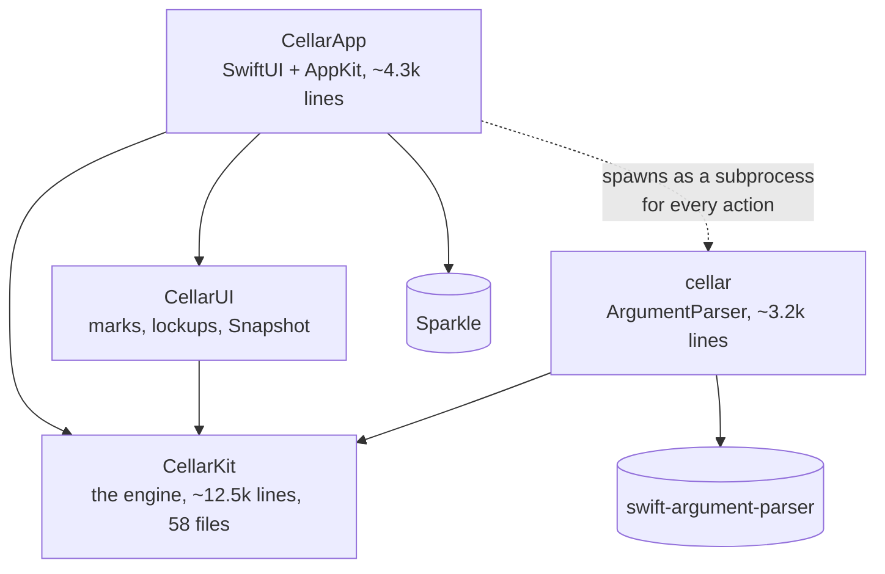
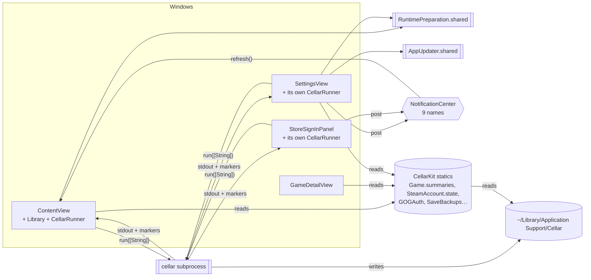
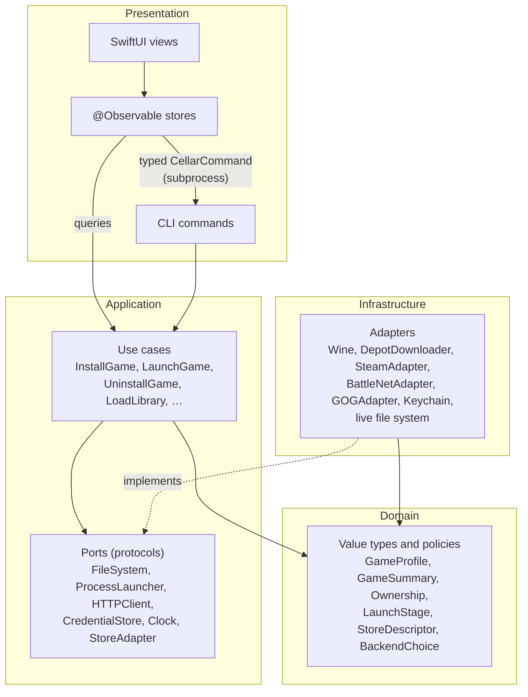
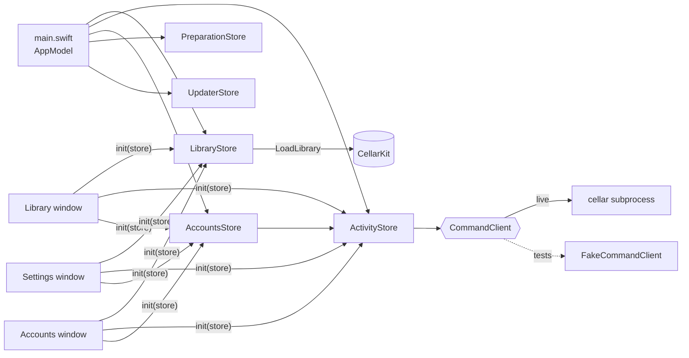
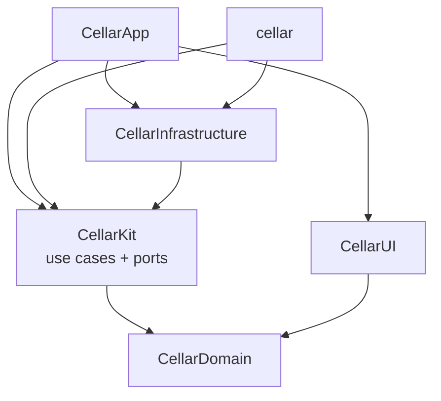

# App architecture — where Cellar is, and where it should go

> **Status:** proposal (#66). Nothing here has been refactored yet. The migration is tracked in
> #67 and lands one small, releasable step at a time (#68–#77).
>
> [`ARCHITECTURE.md`](ARCHITECTURE.md) explains *what Cellar does* — the translation stack, the store
> layer, bottles. This document is about *how the code is organised*: modules, layers, dependencies
> and the flow of state, judged against the clean-architecture practice backends take for granted.

## Contents

1. [Summary](#summary)
2. [How Cellar is built today](#how-cellar-is-built-today)
3. [What is good, and what is not](#what-is-good-and-what-is-not)
4. [Clean architecture, translated to a Swift app](#clean-architecture-translated-to-a-swift-app)
5. [State management: signal stores and their Swift equivalents](#state-management-signal-stores-and-their-swift-equivalents)
6. [The target architecture](#the-target-architecture)
7. [Source layout](#source-layout)
8. [Migration plan](#migration-plan)
9. [Decisions and rejected alternatives](#decisions-and-rejected-alternatives)
10. [Sources](#sources)

## Summary

- **Cellar already has the most important clean-architecture property:** all logic lives in one
  UI-free core (`CellarKit`), and both front-ends (the `cellar` CLI and `CellarApp`) depend on it,
  never the other way round. That is worth keeping exactly as it is.
- **What it lacks is seams.** The core is a set of caseless `enum`s with `static func`s that touch the
  file system, processes, network and Keychain directly. There are no protocols, so nothing can be
  substituted in a test except through the process-wide `CELLAR_HOME` variable. Per-store behaviour
  is a `switch` repeated across ~38 sites. `Game.swift` is 1,100 lines of model, query and
  orchestration together.
- **The app's state is fragmented.** Three windows each own a separate `CellarRunner`, two
  singletons hold global state, views read engine statics directly, and windows coordinate through
  nine untyped `NotificationCenter` names.
- **Recommendation for state:** `@Observable` feature stores — Apple's Observation framework, which is
  the closest Swift equivalent of Angular's signals and NgRx's `signalStore` — owned by one
  composition root and injected into every window. Not TCA: it would solve problems Cellar does not
  have, at the price of a heavy third-party dependency and a rewrite.
- **Recommendation for the core:** use cases over ports (protocols for file system, processes,
  network, credentials, clock), one `StoreAdapter` per store, and eventually SwiftPM targets so the
  compiler enforces the dependency rule.
- **The CLI-as-subprocess boundary stays.** It is a real asset (crash isolation from Wine, a clean
  environment per action, one tested path). It gets a typed contract instead of string arrays.

## How Cellar is built today

### Modules



| Target | Role today | Clean-architecture equivalent |
|---|---|---|
| `CellarKit` | Everything: domain types (`GameSummary`, `Ownership`, `LaunchStage`), policies (`StoreLibrary.verdict`, `BackendChoice`), orchestration (`Game.setUp`, `Game.launch`), and every adapter to the outside world (`Wine`, `DepotTool`, `Keychain`, `Downloader`). | domain + application + infrastructure, in one module |
| `cellar` | One `ParsableCommand` per command group; formats output for a terminal. | presentation (CLI) + composition root |
| `CellarUI` | Store marks, lockups, the generated cover, `Snapshot`. A library so tests can import it. | presentation primitives |
| `CellarApp` | Windows, menus, views, `Library` and `CellarRunner` view models, the Sparkle updater. | presentation (GUI) + composition root |

The dependency direction is correct: nothing in `CellarKit` imports SwiftUI, AppKit or
ArgumentParser, and nothing points back at a front-end. This is the "dependency rule" of clean
architecture, already met at the module level.

### Inside CellarKit

Almost every type is a namespace:

```swift
public enum SaveBackups {
    public static func list(bottle: String) -> [Backup] { … FileManager.default … }
}
```

- **No protocols.** A `grep` for `protocol` in `app/Packages/CellarKit/Sources/CellarKit` finds none. Side effects —
  `FileManager`, `Process` (6 sites), `URLSession` (5), Keychain, `ProcessInfo.environment` — are
  called where they are needed.
- **Configuration is ambient.** `Paths.appSupport` reads `CELLAR_HOME` from the process environment,
  and every location is derived from it. That is how tests isolate the disk today: it works, but it
  is process-global, so two tests cannot use two homes at once.
- **Per-store behaviour is data *and* switches.** `StoreDescriptor` holds the facts as a table
  (good), but behaviour branches on `GameStore` at ~38 `case .steam` sites — 14 in `Game.swift`,
  more in `StoreLibrary`, `Preparation`, `Uninstall`, `Reset`, `StoreIcon` and the CLI's `Setup`.
- **`Game.swift` is the centre of gravity**: `GamePlan`, `GameFacts`, `LaunchRoute`, `GameSummary`,
  the library query (`Game.summaries()`) and the set-up/launch/uninstall orchestration, in 1,100
  lines.
- **Swift 5 language mode**, so no strict concurrency checking; `CellarLog` is
  `@unchecked Sendable`.

### How state flows in the app



The rule in [`skills/swift.md`](../skills/swift.md) is: *actions go through the CLI subprocess,
read-only state comes from CellarKit in-process*. That is, in effect, **CQRS**: commands travel one
path, queries another, and the file system under `Paths.appSupport` is the shared store between
them. After a command finishes, the app re-queries.

That split is sound. The problems are in how the app side is wired:

- **Three `CellarRunner`s.** `ContentView`, `SettingsView` and `StoreSignInPanel` each create one with
  `@StateObject`. "Busy" is per window, so Settings can start a command while the library is
  installing, and the library window does not know a sign-in is running.
- **Global singletons.** `RuntimePreparation.shared` and `AppUpdater.shared` are reached from any
  view.
- **Notifications as an event bus.** Windows tell each other what happened through
  `NotificationCenter` (`cellarAccountsChanged`, `cellarLibraryChecking`, `cellarRefreshLibrary`, …).
  Partly this is forced: Settings and Accounts are separate `NSWindow`s, because a SwiftUI `.sheet`
  inside `NSHostingView` trips the AttributeGraph crash (see `skills/swift.md`), so they do not share a
  view tree. But nothing typed says who listens to what.
- **Views read the engine directly**, e.g. `GameDetailView` calls `SaveBackups.list(…)` and
  `AccountsSection` reads `GOGAuth.isSignedIn`. Those reads touch the disk from inside a view update,
  and the view cannot be previewed or tested without a real Cellar home.
- **A stringly-typed command contract.** Call sites build `["saves", "restore", slug, "--backup", id]`
  by hand; the CLI reports progress by printing marker lines (`LaunchMarker`, `InstallMarker`) among
  the prose. A renamed flag fails at runtime, not at compile time.
- **The view models are `ObservableObject`**, so any `@Published` change invalidates every view
  observing the object. `CellarRunner.log` changes on every line of output.

### How it is tested today

The suite is strong for what it covers: 39 files of fast, hermetic engine tests, offscreen rendering
of the store marks in `CellarUITests`, and tiered Wine and Steam integration tests
([`TESTING.md`](TESTING.md)). Everything is tested at the level of pure functions, or end-to-end
against a real `CELLAR_HOME`. What cannot be tested today is the middle: an app state transition
("Settings signs in, the library refreshes"), or an engine flow with a failing download, without
standing up the real thing.

## What is good, and what is not

| Keep | Change |
|---|---|
| One UI-free core, two thin front-ends | Static-only engine with no seams for I/O |
| `StoreDescriptor` as a table of per-store facts | Per-store behaviour as repeated `switch`es |
| CLI subprocess for actions: crash isolation, clean environment, one tested path | Hand-built argument arrays and prose markers as the contract |
| Commands one path, queries another (CQRS) | Three runners, two singletons and a notification bus as the app's state |
| `CellarUI` as an importable library so views are testable | Views reading disk through engine statics |
| Honesty rules encoded in the engine (`Ownership` has three answers) | `Game.swift` as model + query + orchestration in one file |

## Clean architecture, translated to a Swift app

The backend idea — Robert C. Martin's Clean Architecture, Alistair Cockburn's ports and adapters
(hexagonal), Jeffrey Palermo's onion — reduces to three rules that transfer to an app unchanged:

1. **The dependency rule.** Source dependencies point inward. Domain knows nothing of use cases; use
   cases know nothing of SwiftUI, ArgumentParser, Wine or `FileManager`.
2. **Use cases are the application.** Each thing the system *does* (install a game, launch it, sign
   in) is one object with its dependencies passed in and one entry point. Front-ends call use cases;
   they do not orchestrate.
3. **Dependency inversion at the edges.** The inner layers declare *ports* (protocols) for what they
   need from the outside world; the outer layer supplies *adapters*. A **composition root** —
   `main.swift` in the app, the `@main` command in the CLI — is the only place that knows which
   adapter is real.

What changes in a Swift app compared with a backend:

- **Value types do most of the domain work.** Structs and enums with no I/O *are* the domain layer;
  there is no need for entity base classes.
- **Protocols with a live and a test implementation** replace a DI container. Swift has no runtime
  reflection to make containers pleasant, and the community default is constructor injection, a
  struct of dependencies, or Point-Free's `swift-dependencies` for larger apps.
- **The UI layer is reactive.** SwiftUI re-renders from state, so the presentation layer needs an
  observable model — which is where the state-store question comes in.
- **Concurrency is part of the contract.** Ports should be `Sendable` and `async`, so that moving to
  Swift 6 language mode is a compile-time check and not a hunt for data races.
- **Over-layering is the common failure.** Clean-architecture ports for every type, a `Repository` +
  `UseCase` + `Interactor` + `Presenter` + `Router` for every screen (VIPER), produces more ceremony
  than an app of this size can carry. The goal is the *dependency rule and testable seams*, not a
  folder per pattern.

## State management: signal stores and their Swift equivalents

### The mapping

| Angular | Swift / SwiftUI | Notes |
|---|---|---|
| `signal()` | a stored property of an `@Observable` class | Observation tracks reads per property, per view — the same fine-grained dependency tracking signals give. |
| `computed()` | a computed property on the `@Observable` class | Re-evaluated when the tracked properties it reads change; no memo by default, so keep them cheap. |
| `effect()` | `.task(id:)`, `.onChange(of:)`, or `withObservationTracking` | Side effects belong in intent methods, not in effects, in both worlds. |
| NgRx `signalStore` (`withState`, `withComputed`, `withMethods`, `providedIn`) | `@Observable @MainActor final class FeatureStore` with `private(set)` state, computed properties and intent methods, handed to each window through its initializer | This is the near-exact equivalent and the recommendation below. |
| NgRx `Store` (actions, reducers, effects, selectors) | TCA (`@Reducer`, `Store`, `Effect`, `TestStore`) or a hand-rolled Redux | Full unidirectional data flow with a central state tree. |
| Component with injected service | MVVM: a `View` plus an `ObservableObject`/`@Observable` view model | What Cellar has today, with `ObservableObject`. |

### The options, judged for Cellar

**A. MVVM with `ObservableObject`** (today).
Familiar and dependency-free, but `@Published` invalidates whole objects (a new log line re-renders
every view watching `CellarRunner`), and nothing stops a view model
from being created per window — which is how Cellar ended up with three runners.

**B. `@Observable` feature stores** (recommended).
Apple's Observation framework (macOS 14+) gives per-property tracking with no Combine and no
property wrappers on the state. A store is a plain class: state, derived values, intents. It is the
pattern Apple's own sample code and WWDC sessions use, and it maps one-to-one onto a signal store.
It is a small step from what Cellar has: `Library` and `CellarRunner` already *are* stores, they are
just `ObservableObject`s owned by the wrong thing. Testing is direct: construct the store with fake
dependencies, call an intent, assert on state.
*Costs:* the discipline that TCA enforces (state changes only through intents, effects only in
intents) is convention here, so it has to be written down and reviewed. It requires raising the
minimum to macOS 14; Cellar now requires macOS 27 (#113), so this costs nothing.

**C. The Composable Architecture (TCA).**
Point-Free's library is the most complete unidirectional architecture for Swift: a single state
tree, reducers, effects as values, dependency injection built in, and `TestStore`, which forces a test
to account for every state change and every effect. For a large team with complex, deeply nested
navigation it is a strong choice.
*For Cellar it is the wrong trade:* a large third-party dependency in an app that pins even Sparkle
exactly; noticeable compile-time and macro overhead; a learning curve for every future contributor;
and an all-in rewrite of `CellarApp`. Most of Cellar's actual effects already happen in a
*subprocess*, so TCA's main strength — modelling effects inside the app — has little to model.

**D. Hand-rolled Redux** (one `AppState`, `Action` enum, `reduce` function).
Gives unidirectional flow without a dependency, but recreates a large part of TCA by hand, with more
boilerplate than B and none of TCA's tooling.

### Recommendation

**B: `@Observable` feature stores, with unidirectional rules.** Concretely:

- One store per feature: `LibraryStore`, `ActivityStore` (the single command runner), `AccountsStore`,
  `PreparationStore`, `UpdaterStore`. Each is `@Observable @MainActor final class`.
- State is `private(set)`. Views read state and call intent methods; they never assign to a store.
  The one exception is state that *is* a control's value (the library's search text, filters, sort
  and selection): those are settable and bound with `@Bindable`, as Apple's WWDC23 guidance shows.
  This is the unidirectional part — *view → intent → (use case / command) → state → view* — without
  a framework.
- Stores receive their dependencies in `init`. They never reach for `.shared`, `NotificationCenter`
  or a CellarKit static that does I/O.
- One `AppModel` in `main.swift` creates every store once and hands the same instances to each
  window's root view through its initializer. Separate windows no longer need notifications to stay
  in step: they observe the same objects. Apple's guidance (WWDC23, *Discover Observation*) allows
  either a plain property or `@Environment(Type.self)`; Cellar uses plain properties because every
  window is a hand-built `NSHostingView`, and an initializer parameter is checked by the compiler,
  where a missing `.environment(…)` only fails when that window opens.
- Per-view ephemeral state (hover, a disclosure, a text field being edited) stays in `@State`.

Revisit TCA only if the app grows into deep navigation, many concurrent in-app effects, or several
contributors who need the stricter guard rails.

## The target architecture

### Layers



Arrows point inward; infrastructure depends on the ports, not the other way round.

### Target: the engine

- **Domain** — today's value types and pure policies, moved out of `Game.swift` into their own files:
  `GamePlan`, `GameFacts`, `GameSummary`, `Ownership`, `LaunchStage`, `InstallProgress`,
  `StoreDescriptor`, `StoreLibrary`'s verdict, `BackendChoice`. No I/O. Most already exist; this is
  mostly moving and naming.
- **Ports** — a handful of protocols, all `Sendable`: `FileSystem`, `ProcessLauncher`, `HTTPClient`,
  `CredentialStore`, `Clock`, and `StoreAdapter`. Bundled into one `CellarEnvironment` value with a
  `.live` instance and a test factory (in-memory file system, fixed clock, scripted processes).
  `Paths` becomes a property of that environment, so `CELLAR_HOME` is read once, in the composition
  root.
- **`StoreAdapter`** — one per store (`SteamAdapter`, `BattleNetAdapter`, `GOGAdapter`) answering the
  questions that are `switch`es today: set up the client, is the game installed, is the account
  signed in, ownership, install, launch route, uninstall. `StoreDescriptor` stays the table of
  facts; the adapter is the behaviour. The only remaining `switch` maps a `GameStore` to its adapter.
  Every game comes through a store, so there is no store-less adapter.
- **Use cases** — small structs with injected dependencies and one entry point that reports progress
  as typed events: `InstallGame`, `LaunchGame`, `UpdateGame`, `UninstallGame`, `LoadLibrary`,
  `BackUpSaves`. `Game.setUp` / `Game.launch` become thin calls into these.
- **Static façades stay during migration.** `SaveBackups.list(bottle:)` keeps working as a wrapper
  over `.live`, so callers move over one at a time and no PR has to touch every file.

### Target: the app



- **`AppModel`** is the composition root: built once in `applicationDidFinishLaunching`, holding every
  store, injected into every `NSHostingView`. Menu items call store intents directly instead of
  posting notifications.
- **`ActivityStore`** replaces the three `CellarRunner`s: one busy state, one log, one launch stage, for
  the whole app.
- **`CommandClient`** is the app's port to the CLI: `run(CellarCommand) -> AsyncStream<CommandEvent>`.
  The live client spawns the subprocess, exactly as `CellarRunner` does; a fake makes every store
  testable without a CLI binary.
- Stores live in the app target, and any that need testing without launching the app move to a
  library target (as `CellarUI` did for the marks), because a test cannot import an executable.

### The app ↔ CLI boundary

Keep the subprocess. Give it a contract:

- **`CellarCommand`** in CellarKit — an enum with one case per command the app issues, rendering its
  own argument list. A test parses every case with the CLI's ArgumentParser types, so a renamed flag
  fails `app/Scripts/test.sh` instead of a player's click.
- **Typed progress events** — the use cases already know their stages; the CLI emits them as
  versioned JSON lines (`{"v":1,"type":"stage","stage":"starting"}`) separate from the prose the
  player reads, and the command client decodes them. The prose markers stay until an app that reads
  the new form has shipped.

### Target module graph

The final step lets SwiftPM enforce the layers:



Only composition roots import `CellarInfrastructure`: the CLI's `main`, the app's `main.swift` and
the tests' set-up. Each calls `CellarInfrastructure.install()` to register the store adapters with
CellarKit's `StoreAdapters` before anything runs. The app needs it too: its actions go through the
CLI, but it still reads the library and the store clients' state in-process. No other file in the
app imports it, and `ArchitectureTests` fails the build if a view or store does, or if an entry
point forgets to call `install()`. Every target is in Swift 6 language mode.

## Source layout

The checkout splits at the top into the Mac app and the website, with what both use beside them:

```
app/                  the Mac app
  Package.swift       the app shell: the two executables and the tests
  Packages/           the libraries, each a local Swift package with its own Package.swift
    CellarDomain/     depends on nothing
    CellarKit/        depends on CellarDomain (CellarKit + CellarInfrastructure)
    CellarUI/         depends on CellarDomain only
  src/                CellarApp, cellar
  tests/              CellarKitTests, CellarUITests, CellarIntegrationTests
  Resources/          icon, localizations, the update key
  Shim/               the Dock shim and Cellar's SDL patches (C)
  Scripts/            build, test, package, sign, release
pages/                the GitHub Pages site: gen-site.py builds pages/dist/, check-site.py checks it
profiles/             the game database: bundled into the app, and the site's game list
docs/  .github/  licenses/  README, LICENSE, NOTICE …
```

**Boundaries are compile errors.** A layer can import only what its package's `Package.swift`
declares, so CellarDomain cannot reach the engine and CellarUI cannot reach the engine or the adapters
however a file is written. What the UI needs from the machine comes in through a domain port that
the composition root fills: `StoreIcons.use(InstalledStoreArtwork())` in `main.swift` tells the
store marks where the stores' own icons are (`StoreArtworkSource`). `ArchitectureTests.packageDependencies` pins each package's declared dependencies,
so adding an arrow is a deliberate change to that test. Within a package, `public` is the only way
out: everything else is `internal` to it.

Inside each target, files are grouped by feature, and every file holds one top-level type, named
after it. An extension of a type that lives elsewhere goes in `Type+Topic.swift`
(`GameStore+StoreStyle.swift`). Nested types stay with their parent. `ArchitectureTests.oneTypePerFile`
and `featureFolders` fail the build when a file gains a second type or a file is left loose at a
target's root (#133).

```
Packages/CellarDomain/Sources/CellarDomain/      pure types, Foundation only, no I/O
  Store/  Install/  Launch/  Events/  Core/  Commands/  About/  Checks/
  Diagnostics/  Game/  Library/  Runners/  Settings/  Storage/
Packages/CellarKit/Sources/CellarKit/            the engine
  Core/                environment, paths, version, credits
  Game/                plans, facts, summaries, updates, play time
  UseCases/            LoadLibrary, SetUpGame, InstallGame, LaunchGame, UninstallGame
  Stores/              the StoreAdapter port and registry, the library verdict, store icons
    Steam/  BattleNet/  GOG/
  Runners/             Wine, runners, prefixes, preparation, app bundles, the Dock shim
  Library/             the profile database and the library query
  Settings/            performance, language, backend, controllers, wheels
  Storage/             game storage, saves, backups, uninstall, reset
  Credentials/         keychain, private files
  Diagnostics/         log, diagnostics report, frame stats
  System/              shell, processes, downloads, environment checks
  Codecs/              VDF, protobuf, PE, CRC32, archives
Packages/CellarKit/Sources/CellarInfrastructure/ the concrete store adapters
  Adapters/
Packages/CellarUI/Sources/CellarUI/              presentation primitives a test can import
  Marks/  Progress/  Snapshot/
src/CellarApp/         the SwiftUI app; main.swift is the composition root
  App/                 AppModel, AppDelegate, activity, updater
  Features/            Library/  GameDetail/  Accounts/  Settings/  Welcome/  Launch/
src/cellar/            the CLI; Cellar.swift is the entry point
  Commands/            Games/  Stores/  Maintenance/
  Output/
```

The models every layer trades in (errors, the CLI command contract, log levels, graphics backends,
runner specs, removal scope, ownership, check results, languages, performance switches) are
declared in CellarDomain, and `ArchitectureTests.modelsLiveInTheDomain` keeps them there;
`domainDoesNoIO` keeps the disk, processes and the network out of it.

Next steps (#133): the repository protocols and the use cases move into CellarDomain, and the I/O
into a CellarData package (absorbing CellarKit and CellarInfrastructure); then each app feature
gets an `@Observable` view model, a smart view and dumb subviews.

## Migration plan

Each step is one issue and one small PR, leaves `main` releasable, and changes no player-visible
behaviour. Steps 1–5 touch only the app, so they barely collide with engine work happening in
parallel. Steps 6–10 touch hot engine files and should be scheduled when no other stream is editing
them.

| # | Step | Issue | Status |
|---|---|---|---|
| 1 | Raise the minimum macOS to 14 | #68 | Done (#97) |
| 2 | Typed `CellarCommand` between the app and the CLI, checked by `cellar selftest` | #69 | Done (#100). `CommandClient` left out: a test can't import the app executable, so the testable rules moved into CellarKit instead |
| 3 | One shared `ActivityStore` for every window, created by `AppModel` | #70 | Done (#100) |
| 4 | `LibraryStore` as `@Observable`, its rules in CellarKit's `LibraryQuery`; library notifications become store calls | #71 | Done (#100) |
| 5 | `AccountsStore`, `RuntimePreparation`, `AppUpdater` as `@Observable` stores; no app singletons | #72 | Done (#100) |
| 6 | `CellarEnvironment` (home + clock) in CellarKit, proven on save backups | #73 | Done (#100) |
| 7 | One `StoreAdapter` per store; no `switch plan.store` left in set-up, install, open or launch | #74 | Done (#100) |
| 8 | `Game.swift` split into domain types and use cases (`LoadLibrary`, `SetUpGame`, `InstallGame`, `LaunchGame`, `UninstallGame`) reporting `GameEvent`s | #75 | Done (#100) |
| 9 | Versioned JSON-line events (`cellar … --events`, `CommandEvent`); the old markers still read | #76 | Done (#100) |
| 10 | SwiftPM targets for the layers; Swift 6 mode per target | #77 | Done (#100, #115): `CellarDomain`, then `CellarInfrastructure` holding the store adapters behind `StoreAdapters`, explicit imports, Swift 6 and Approachable Concurrency per target |

**How to know it worked:** after step 5, a store test can say "a sign-in finishing refreshes the
library" with a fake command client and no Wine. After step 7, adding a store is a `GameStore` case,
an adapter and a CLI command group. After step 10, a view that imports the infrastructure does not
compile.

**What does not change:** the store rules in [`ARCHITECTURE.md`](ARCHITECTURE.md), the honesty rules
in [`skills/ux.md`](../skills/ux.md), the `HSplitView` / separate-`NSWindow` workarounds, the verification
ladder, and the fact that every game is installed through its store.

## Decisions and rejected alternatives

- **Keep the CLI subprocess** rather than calling use cases in-process from the app. In-process would
  be simpler, but Wine, DepotDownloader and Steam are long-running, crash-prone children with
  environment requirements of their own; a subprocess isolates them and keeps the CLI and the app on
  literally the same path. Revisit only if the subprocess becomes a measured bottleneck.
- **No DI container or `swift-dependencies` yet.** A `CellarEnvironment` struct passed through
  initialisers is enough for a codebase of this size and adds no dependency. If threading it through
  becomes painful, `swift-dependencies` is the natural upgrade and works without TCA.
- **No TCA.** See *State management* above.
- **No VIPER / per-screen Interactor-Presenter-Router.** Too much ceremony for the size of the app.
- **No big-bang rewrite.** Every step keeps static façades over the new code until the last caller
  has moved.

## Checked against Apple's guidance (2026-10-31)

The first version of this document leaned on Apple's Observation documentation and WWDC23 only.
After the migration landed in #100 it was checked again against Apple's concurrency, Swift 6 and
packaging guidance. What matches, and what does not yet:

| Apple's guidance | Cellar | Status |
|---|---|---|
| `@Observable` models; read as plain properties, `@Bindable` for bindings, `@Environment` for app-wide models (WWDC23 10149) | `@Observable @MainActor` stores, plain-property injection, `@Bindable` for the library's controls | Matches (environment not used, reason above) |
| Start on the main actor; UI and model classes stay main-actor, not `Sendable` (WWDC25 268) | Every store is `@MainActor final class`, none is `Sendable` | Matches |
| Value types are the safest thing to share; make them `Sendable` (WWDC25 268) | Domain types are `Sendable` structs and enums; `LaunchRoute` was not and now is | Fixed in #100 |
| Adopt Swift 6 one module at a time (`swiftLanguageMode` per target, SE-0435; Swift 6 migration guide) | Every target sets its own `swiftLanguageMode` | Done in #77 (see `Package.swift` for each target's mode) |
| Turn on *Approachable Concurrency*, and default main-actor isolation for UI modules (WWDC25 268, SE-0466, SE-0461, SE-0470) | `swift-tools-version: 6.2`; `CellarApp` and `CellarUI` use `.defaultIsolation(MainActor.self)` with Approachable Concurrency; CellarKit stays nonisolated, as a library should | Done in #77 |
| Work that blocks the main thread moves off it (`@concurrent`), after profiling (WWDC25 268) | `LibraryStore.refresh()` runs `LoadLibrary` (profiles, icons, bottle state) on the main actor | Gap: profile it in Instruments, then move `LoadLibrary` into a `@concurrent` function if it shows |
| Narrowest access that works; `package` for what only the package uses (SE-0386, SE-0409) | `StoreDescriptor.components(fromHex:)` and `GameStore.sortIndex` were `public` for tests and the CLI | Fixed in #100: now `package` |
| Re-exporting a module is not an official Swift feature (`@_exported` is underscored; SE-0409 left it unspecified) | Every file that uses a domain type writes `import CellarDomain`; nothing is re-exported | Fixed in #77 |
| Organise app code into local packages and library targets (Apple, *Organizing your code with local packages*) | One SwiftPM package, library targets per layer | Matches |

## Checked against enterprise architecture criteria (2026-10-31)

The same pass, against the rules clean and hexagonal architecture are judged by. "Enforced" means a
test fails the build when the rule breaks, not that a reviewer has to notice.

| Criterion | Cellar | Status |
|---|---|---|
| Dependencies point inward: domain ← engine ← infrastructure ← composition roots | Local Swift packages: `CellarDomain` (no dependencies) ← `CellarKit` (engine + adapters) ← `CellarUI`; the app shell depends on all three. A package can only import what its manifest declares | Pass, enforced by the compiler (`app/Packages/*/Package.swift`) and pinned (`ArchitectureTests.packageDependencies`) |
| The domain is pure: no I/O, no framework | `CellarDomain` imports Foundation only | Pass, enforced (`ArchitectureTests.domainIsPure`) |
| Ports and adapters: the core depends on interfaces, not implementations | `StoreAdapter` port in CellarKit; Steam, Battle.net and GOG adapters in `CellarInfrastructure`; CellarKit never names one | Pass, enforced (`engineNamesNoConcreteAdapter`, `useCasesDoNotSwitchOnStore`) |
| Composition root: wiring happens once, at the edge | `CellarInfrastructure.install()` in the CLI's `main`, the app's `main.swift` and the test homes; nowhere else in the app | Pass, enforced (`entryPointsInstallInfrastructure`, `onlyTheAppsRootImportsInfrastructure`) |
| The UI layer holds no business logic | Library rules live in CellarKit's `LibraryQuery`; actions are `CellarCommand`s run by the CLI; views read `@Observable` stores | Pass, by structure (CellarKit has no UI import: `engineHasNoUI`) |
| Use cases are explicit and testable without I/O | `LoadLibrary`, `SetUpGame`, `InstallGame`, `LaunchGame`, `UninstallGame` take their dependencies in `init` | Pass, tested (`UseCaseTests` with a recording adapter) |
| State management: one owner, unidirectional updates | `AppModel` owns every `@Observable @MainActor` store; no singletons, no notification wiring | Pass, tested (`LibraryQueryTests`, store tests) |
| Contract between processes is typed and versioned | `CellarCommand` (checked by `cellar selftest` against the CLI's parser), `--events` JSON lines with `v` | Pass, tested (`CellarCommandTests`, `CommandEventTests`, `cellar selftest`) |
| Compile-time data-race safety | Swift 6 language mode in every target, tests included | Pass, enforced (`swift6Everywhere`, and the compiler) |
| Code is findable: feature folders, one type per file | Every target grouped by feature; each file one top-level type, named after it | Pass, enforced (`oneTypePerFile`, `featureFolders`) |
| Main thread kept free of blocking work | `LibraryStore.refresh()` still runs `LoadLibrary` on the main actor | Open: needs an Instruments trace on a real library before moving it (Apple's own advice, WWDC25 268). Not measurable from CI |

## Sources

- Robert C. Martin, *The Clean Architecture* (2012) —
  <https://blog.cleancoder.com/uncle-bob/2012/08/13/the-clean-architecture.html>
- Alistair Cockburn, *Hexagonal architecture (ports and adapters)* —
  <https://alistair.cockburn.us/hexagonal-architecture/>
- Apple, *Observation* framework — <https://developer.apple.com/documentation/observation>
- Apple, *Migrating from the Observable Object protocol to the Observable macro* —
  <https://developer.apple.com/documentation/swiftui/migrating-from-the-observable-object-protocol-to-the-observable-macro>
- Apple, *Managing model data in your app* —
  <https://developer.apple.com/documentation/swiftui/managing-model-data-in-your-app>
- WWDC23, *Discover Observation in SwiftUI* — <https://developer.apple.com/videos/play/wwdc2023/10149/>
- WWDC25, *Embracing Swift concurrency* — <https://developer.apple.com/videos/play/wwdc2025/268/>
- Apple, *Organizing your code with local packages* —
  <https://developer.apple.com/documentation/xcode/organizing-your-code-with-local-packages>
- SE-0435, *Swift language version per target* — <https://forums.swift.org/t/se-0435-swift-language-version-per-target/71546>
- SE-0409, *Access-level modifiers on import declarations* —
  <https://forums.swift.org/t/accepted-with-modifications-se-0409-access-level-modifiers-on-import-declarations/67666>
- Approachable concurrency in Swift packages (SE-0466, SE-0461, SE-0470 settings) —
  <https://useyourloaf.com/blog/approachable-concurrency-in-swift-packages/>
- Point-Free, *The Composable Architecture* —
  <https://github.com/pointfreeco/swift-composable-architecture>
- Point-Free, *swift-dependencies* — <https://github.com/pointfreeco/swift-dependencies>
- Angular, *Signals* guide — <https://angular.dev/guide/signals>
- NgRx, *SignalStore* — <https://ngrx.io/guide/signals/signal-store>
